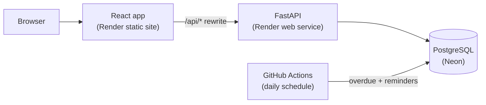

# My Properties 4U


A property management platform where landlords manage properties, units and leases, tenants pay rent and report maintenance issues, and admins audit every change. Built as a full-stack portfolio project with a focus on backend correctness: concurrency-safe payments, database-enforced rules and an audit trail.

**Live demo:** https://my-properties4u-1.onrender.com/login

> **Payments are simulated.** No real money moves and no card details are collected or stored.
>
> The demo runs on free tiers. The API sleeps when idle, so the first request after a quiet spell can take up to a minute.

## Demo accounts

All accounts use the password `Demo1234!`.

| Role | Email |
|---|---|
| Landlord | `landlord1@example.com`, `landlord2@example.com` |
| Tenant | `tenant1@example.com` to `tenant12@example.com` |
| Admin | `admin@example.com` |

## Features

- **Landlords:** dashboard (occupancy, expected vs collected income, overdue rent, open requests), properties, units, leases with auto-generated rent schedules, and a maintenance board.
- **Tenants:** lease summary, rent schedule with a Pay Rent button, and a maintenance request form.
- **Admins:** a filterable, paginated audit log showing old and new values for every change.
- **Background jobs:** overdue rent marking and upcoming-rent reminders, run daily.

## Architecture



## Tech stack

- **Backend:** FastAPI, SQLAlchemy 2.0, Alembic, psycopg 3, Pydantic, argon2 password hashing, JWT auth, APScheduler.
- **Database:** PostgreSQL 16.
- **Frontend:** React, TypeScript, Vite, TanStack Query, React Router, Recharts.
- **DevOps:** Docker and Docker Compose, GitHub Actions CI (ruff, pytest, ESLint, build), deployed on Render and Neon.
- **Tests:** 51 pytest tests, including real concurrency tests.

## Design decisions

- **Payments are safe to retry and to race.** A payment locks the rent charge row (`SELECT ... FOR UPDATE`), checks the `Idempotency-Key`, checks the balance, then records the payment, all in one transaction. The same key with the same payload replays the original result. The same key with a different payload, or an overpayment, returns 422. A unique constraint on `(user_id, idempotency_key)` is the database backstop.
- **Overlapping leases are impossible.** A PostgreSQL exclusion constraint (`btree_gist` with a date range) blocks overlapping active leases on a unit, and the API turns the violation into a 409.
- **Every change is audited.** Lease creation, payments and maintenance changes write an audit row with old and new values (JSONB) in the same transaction as the change.
- **Ownership failures return 404, not 403,** so the API doesn't reveal whether another landlord's record exists.
- **Maintenance follows a strict workflow:** submitted, assigned, in progress, resolved. Skipping a step returns 409, and the row is locked while it changes.
- **Dashboard figures are computed in SQL** from a database view of charge balances.
- **APScheduler instead of Celery:** the jobs are small and idempotent, and a Redis broker would add infrastructure for no benefit. In production the job runs from a scheduled GitHub Actions workflow because the free hosting tier has no always-on worker.

## Run it locally

You need Docker Desktop, Python 3.13 and Node 22.

```powershell
# 1. Start the database, API and worker (API on http://localhost:8000)
docker compose up -d --build

# 2. Create the backend environment and load demo data
cd backend
python -m venv .venv
.\.venv\Scripts\Activate.ps1
pip install -r requirements.txt
copy .env.example .env
python -m scripts.seed --reset

# 3. Start the frontend (http://localhost:5173)
cd ..\frontend
npm ci
npm run dev
```

Check `backend\.env` points at `localhost:5432` before seeding. API docs are at http://localhost:8000/docs.

Run the checks from `backend` with the venv active:

```powershell
ruff check .
ruff format --check .
pytest -v
```

The tests use a separate database (`property_mgmt_test`) so they never touch your demo data.

## Project layout

```
backend/    FastAPI app, migrations, tests, seed script
frontend/   React app
docs/       Extra documentation
.github/    CI and scheduled job workflows
```

## Further reading

- [Concurrency and payment safety](docs/concurrency.md): how double payments are prevented, with test evidence.
- [Database design](docs/er-diagram.md): entity-relationship diagram and the rules the database enforces.
