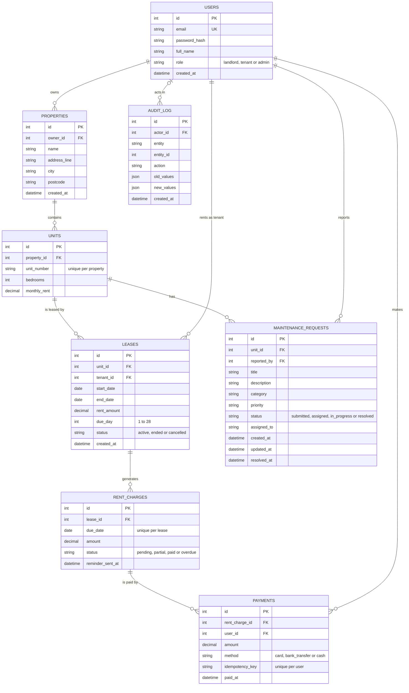

# Database design

Entity-relationship diagram of the PostgreSQL schema. `PK` is a primary key, `FK` a foreign key and `UK` a unique column.

## Rules enforced by the database

- **No overlapping active leases per unit:** an exclusion constraint (`btree_gist`, a date range over `start_date` and `end_date`, applied where `status = 'active'`).
- **No duplicate payments:** a unique constraint on `(user_id, idempotency_key)`.
- **One rent charge per lease per due date:** a unique constraint on `(lease_id, due_date)`.
- **Valid values:** check constraints on roles, statuses, categories, priorities, payment methods, positive amounts, the lease date order and `due_day`.
- **Balances:** a view, `v_charge_balances`, gives each charge's paid and outstanding amounts for the dashboard queries.

`audit_log.entity_id` points at a row in whichever table `entity` names, so it is deliberately not a foreign key.
